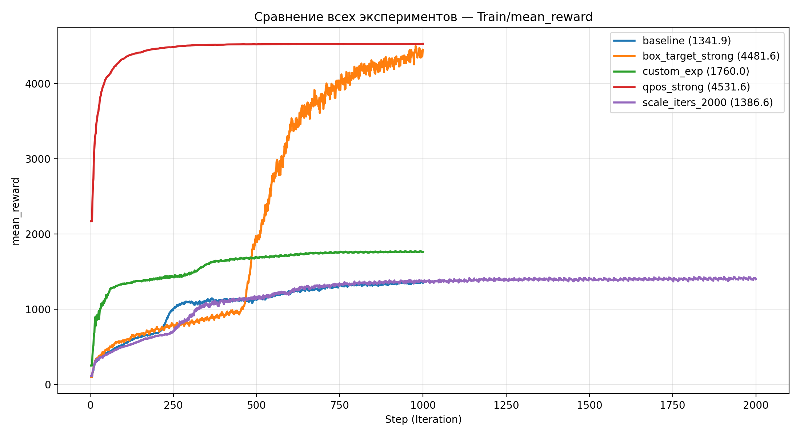
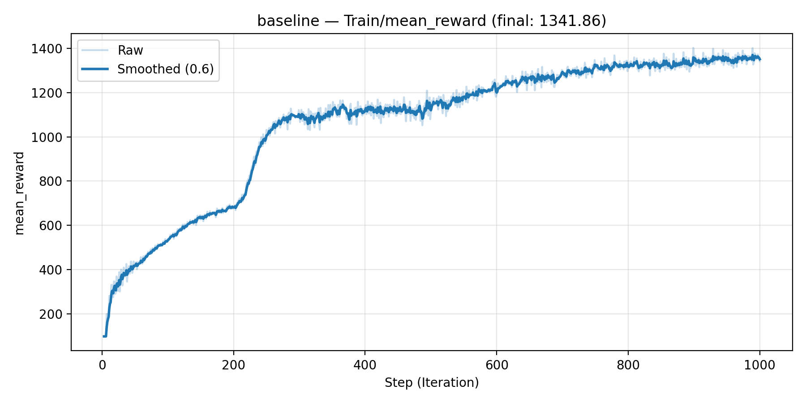
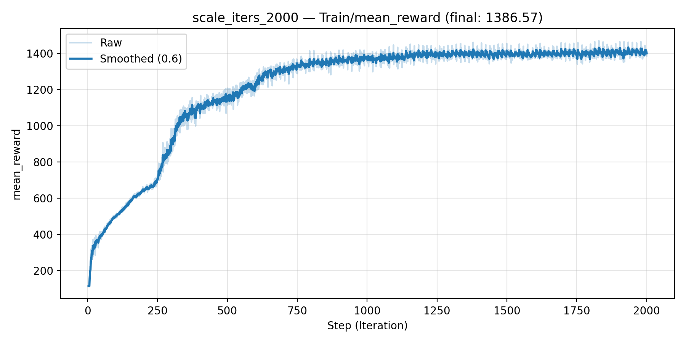
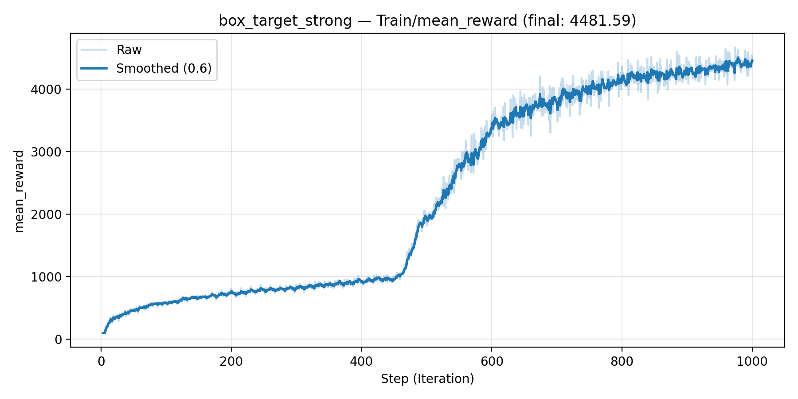
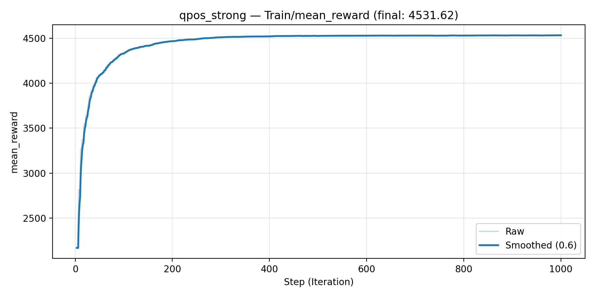
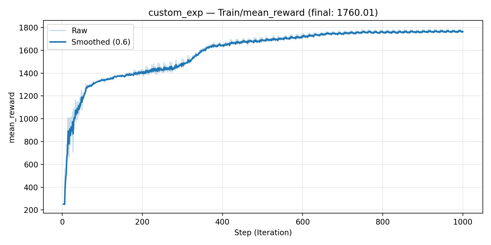

# Отчет

_Белебезьев Степан, 9 группа_

## Параметры

| Параметр          | Файл / способ доступа                                              | Имя ключа / флага | Значение по умолчанию |
| ----------------- | ------------------------------------------------------------------ | ----------------- | --------------------- |
| num_envs          | `./train.ipynb` : `NUM_ENVS`                                       | `--num_envs`      | `4096`                |
| learning_rate     | `./train.ipynb` : `cfg_dict['algorithm']['learning_rate']`         |                   | `0.001`               |
| max_iters         | `./train.ipynb` : `MAX_ITERS`                                      | `--max_iters`     | `1001`                |
| box_target        | `./train.ipynb` : `env_cfg.reward_config.scales.box_target`        |                   | `8.0`                 |
| gripper_box       | `./train.ipynb` : `env_cfg.reward_config.scales.gripper_box`       |                   | `4.0`                 |
| robot_target_qpos | `./train.ipynb` : `env_cfg.reward_config.scales.robot_target_qpos` |                   | `0.1`                 |

## Изменение относительно baseline

| Эксперимент       | Изменение в коде                                                                    | mean_reward                           | SR (k/10) | Время             | Поведение                                                                                              |
| ----------------- | ----------------------------------------------------------------------------------- | ------------------------------------- | --------- | ----------------- | ------------------------------------------------------------------------------------------------------ |
| baseline          | `EXP_NAME = "baseline"`                                                             | Плато на высоком уровне, `1341.86`    | 9/10      | 1778 с (29.6 мин) | Дотягивается до куба, поднимает, успешно несет к цели                                            |
| scale_iters_2000  | `EXP_NAME = "scale_iters_2000"`, `MAX_ITERS = 2001`                                 | Устойчивое плато, `1386.57`           | 10/10     | 3573 с (59.6 мин) | Дотягивается, поднимает, стабильно удерживает в целевой точке                                    |
| box_target_strong | `EXP_NAME = "box_target_strong"`, `env_cfg.reward_config.scales.box_target = 40.0`  | Резкий рост после ~470 ит., `4481.59` | 10/10     | 1707 с (28.5 мин) | Быстро дотягивается, поднимает, целенаправленно несет к цели (высокая награда за счет масштаба) |
| qpos_strong       | `EXP_NAME = "qpos_strong"`, `env_cfg.reward_config.scales.robot_target_qpos = 30.0` | Быстрый выход на плато, `4531.62`     | 0/10      | 1384 с (23.1 мин) | Удерживает стартовую/целевую позу суставов (reward hacking), не тянется к кубу, не поднимает куб |

## Графики обучения

### Сравнение всех экспериментов

### Отдельные запуски
- **Baseline**: 
- **Scale Iters 2000**: 
- **Box Target Strong**: 
- **Qpos Strong**: 
- **Custom Exp (gripper_box = 12.0)**: 

## Самостоятельный эксперимент

### Гипотеза

**Параметр**: `gripper_box` (в `env_cfg.reward_config.scales.gripper_box`).  
**Изменение**: `env_cfg.reward_config.scales.gripper_box = 12.0` (увеличение в 3 раза относительно значения по умолчанию `4.0`).  
**Ожидание по `mean_reward`**: вырастет (как за счёт более быстрого наведения схвата на куб, так и за счёт увеличения веса слагаемого `gripper_box` в итоговой сумме наград).  
**Ожидание по `SR`**: останется высоким (на уровне `baseline`, 8–10/10) либо ускорится сходимость на ранних итерациях.  
**Обоснование**: повышение веса награды за сближение схвата с кубом усиливает градиент на первом этапе задачи (поиск и захват объекта), помогая политике быстрее преодолеть начальное плато.

### Результат

| Эксперимент | Изменение в коде                                                             | mean_reward                        | SR (k/10) | Время             | Поведение                                                                 |
| ----------- | ---------------------------------------------------------------------------- | ---------------------------------- | --------- | ----------------- | ------------------------------------------------------------------------- |
| baseline    | `EXP_NAME = "baseline"`                                                      | Плато на высоком уровне, `1341.86` | 9/10      | 1778 с (29.6 мин) | Дотягивается, поднимает, успешно несет к цели                       |
| custom_exp  | `EXP_NAME = "custom_exp"`, `env_cfg.reward_config.scales.gripper_box = 12.0` | Быстрый выход на плато, `1760.01`  | 9/10      | 1639 с (27.3 мин) | Очень быстро наводит схват на куб, уверенно захватывает и несет к цели |

### Подтверждение по `mean_reward`

Гипотеза подтвердилась: итоговый `mean_reward` вырос с `1341.86` до `1760.01` (+418.15), при этом резкий скачок обучения произошёл уже на первых ~70 итерациях (против ~220 итераций у `baseline`).

### Подтверждение по SR

Гипотеза подтвердилась: показатель успешности остался на высоком уровне `9/10` (на уровне `baseline`), так как агент быстро осваивает захват и перенос объекта без деградации целевой траектории.

### Объяснение

Увеличение веса `gripper_box` с `4.0` до `12.0` сделало стадию сближения схвата с кубом приоритетной с самого начала обучения. Это устранило длительный этап случайного блуждания манипулятора и позволило политике быстрее перейти к фазе подъёма и переноса куба в целевую точку без деградации конечного качества выполнения задачи.

## Ссылка на документ

[Яндекс документ](https://disk.yandex.ru/i/h6t2pdIwA-sG8w)
